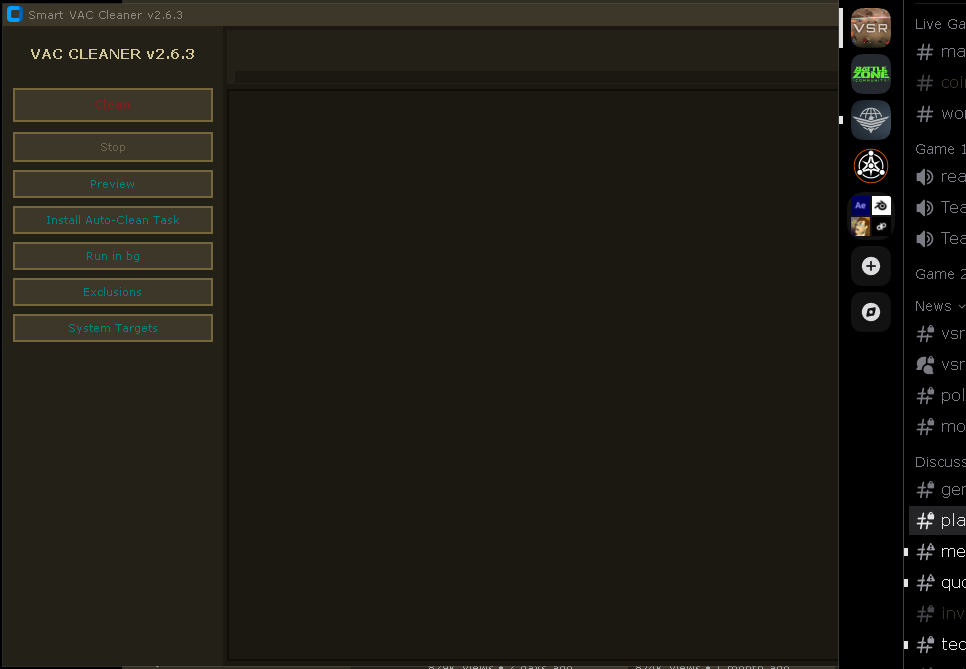

# Smart VAC Cleaner

**v2.6.10**




Kaasaskantav, ohutu, kaasaegne prügipuhastaja Windowsile. GUI + CLI + Tegumihaldur.

Ohutu vaikimisi: dry-run, kuni pole antud `--delete`. Kõik kaasaskantavate
rakenduste juured on alati konfigis kirjas; puhastatakse ainult need, mis
selles arvutis reaalselt olemas on, ja ainult tuntud prügimustrid nende sees.
Puuduvad kettad jäetakse vaikselt vahele, vigu ei teki kunagi.

## Mida puhastatakse

| Kiht | Mida | Kus |
|---|---|---|
| Süsteem | Temp, krahhi-dumbid, Exploreri pisipildid, Windows Update'i vahemälu, DNS-vahemälu, prügikast, 100+ rakenduste vahemälusid (brauserid, Node/uv/pip vahemälud, VS Code pere, Eagle, OBS, Discord...) | `%TEMP%`, `%LOCALAPPDATA%`, `%APPDATA%` |
| Deep C: Junk | Uuendajate jäänused, `*.exe.tmp`, Viber QmlWebCache, Yandex.Disk logid, ODIS logid jms | `%LOCALAPPDATA%`, `%TEMP%` |
| Kaasaskantavad juured | Tuntud prügimustrid seadistatud juurte sees | `portable_roots` konfigis |
| Kasutaja reeglid | Oma teed + glob-mustrid | `custom_rules` konfigis |

## Ohutus (kaitse sügavuti)

- **Dry-run vaikimisi** — GUI nupp "Puhasta" kustutab päriselt (küsib eelnevalt kinnitust), CLI nõuab selgesõnalist `--delete`
- **Must nimekiri**: `C:\`, `C:\Windows`, kasutajaprofiil, Program Files, programmi enda kaust — kasutaja-antud (portable/custom) juur ei tohi kunagi olla kaitstud tee ega selle alamkaust; sisemised ülevaadatud süsteemi sihtmärgid on eraldi ulatusega ja piirduvad oma SafetyGuard juuriga
- **Minimaalne tee sügavus**: madalad teed (vähem kui 5 komponenti) lükatakse tagasi
- **Käivate protsesside kontroll**: rakendus, mis sihtmärki kasutab, jäetakse vahele
- **Sümbollingid ja `..`**: sümbollingid lükatakse tagasi; `..` segmendid kanoniseeritakse ning saadud tee piiratakse sihtmärgijuuriga ja kontrollitakse uuesti — juurest välja viiv `..` lükatakse tagasi
- **Never-delete nimed**: `login data`, `bookmarks`, `cookies`, `database` jne.
- **Erandid**: `exclude_patterns` / `exclude_paths` konfigis
- **Varukoopiad**: tavalisi `.bak` tagasipööramise faile (nt `app.asar.bak`) ei kustutata kunagi automaatselt
- Iga kustutamine läbib oma juure `SafetyGuard`i; vead loendatakse, pole kunagi saatuslikud

## Nõuded

- Windows 10/11
- Python 3.10+

## Paigaldus

```bat
python -m venv .venv
.venv\Scripts\activate
pip install -r requirements.txt
```

Paketina (lisab käsu `vac-cleaner`):

```bat
pip install .
vac-cleaner --status
```

Pole Pythonit? Võtke `SmartVACCleaner.exe` GitHubi
[Releases](https://github.com/vacterro/SMART-VAC-CLEANER/releases) lehelt —
täiesti kaasaskantav, konfig ja logid elavad exe kõrval.

## Exe ise ehitamine

```bat
powershell -ExecutionPolicy Bypass -File build_exe.ps1
```

Tulemus: `dist\SmartVACCleaner.exe` (PyInstaller onefile). Iga `v*` teegi
peale ehitab CI exe ja laeb selle artefaktina automaatselt üles.

## GUI

```bat
python _SMART_VAC_CLEANER.py
```

Seitse nuppu: **Puhasta** (päris kustutamine — küsib eelnevalt kinnitust),
**Peata**, **Eelvaade** (täielikult read-only, näitab, mis kustutataks),
**Paigalda autopuhastuse ülesanne**, **Käivita taustal** (käivitab
eraldiseisva peidetud täispuhastuse taustal), **Välistused** (ära-kustuta
mustrite ja teede muutmine), **Süsteemi sihtmärgid** (riskantsete sihtmärkide
sisse lülitamine — Prügikast, DNS-i vahemälu, Windows Update'i vahemälu; valik
salvestatakse konfigi). Progressiribad kategooriate kaupa, täielik
logiakken; iga käivitus jõuab ka `logs\clean_*.log` faili.

## CLI

CLI on **vaikimisi dry-run** — ainult aruanne, mis kustutataks. Päris
kustutamiseks lisage `--delete`. `--dry-run` sunnib eelvaate ka `--delete`
juures.

| Lipp | Mõju |
|---|---|
| `--cli` | Sundida konsoolirežiim |
| `--portable` / `--system` / `--custom` | Puhastuskihtide valik (vaikimisi dry-run) |
| `--all` | Kõik kihid korraga |
| `--delete` | **Päris kustutamine** (ilma selleta ainult eelvaade) |
| `--dry-run` | Sunnitud eelvaade ka `--delete` juures |
| `--status` | Näita prügi mahtu eesmärkide kaupa; midagi ei kustutata |
| `--analyze-caches` | Otsi AppData vahemälu kaustu > 5 MB |
| `--sys-targets` | Süsteemsihtmärkide loend komadega (`System Temp`, `User Temp`, ...) |
| `--exclude` | Lisamustrid eranditeks (`--exclude "*.db,*.tmp"`) |
| `--hidden` | Peida konsooliaken (Tegumihaldurile) |
| `--install-task` | Paigalda igapäevane vaikne täispuhastus |
| `--time HH:MM` | Ülesande käivitusaeg (vaikimisi `09:00`) |

Näited:

```bat
REM kõige eelvaade
python _SMART_VAC_CLEANER.py --cli --all

REM kõige päris kustutamine
python _SMART_VAC_CLEANER.py --cli --all --delete

REM eelvaade, siis kustutamine; --dry-run võidab alati
python _SMART_VAC_CLEANER.py --cli --all --delete --dry-run
```

Kui palju prügi on kogunenud:

```bat
python _SMART_VAC_CLEANER.py --status
```

### Autopuhastus (Tegumihaldur)

```bat
python _SMART_VAC_CLEANER.py --install-task --time 09:00
```

Paigaldab ülesande `SmartVACCleaner` (maksimaalsed õigused, peidetud aken). Eemaldamine:

```bat
python _SMART_VAC_CLEANER.py --uninstall-task
```

See eemaldab nii baasülesande `SmartVACCleaner` kui ka kasutajapõhise
`SmartVACCleaner_<USERNAME>`, kui see paigaldus.

## Konfiguratsioon

`cleaner_config.json` luuakse vaikimisi väärtustega siis, kui GUI käivitub või
esimest korda jookseb päris kustutamine. Lähtekood ja kaasaskantav exe hoiavad
seda rakenduse kõrval; paigaldatud wheel kirjutab `%LOCALAPPDATA%\SmartVACCleaner`
(`SMARTVAC_DATA_DIR` möörab tee). Kirjutuskaitstud eelvaade ja `--status`
puuduvat konfiguratsiooni ei loo. Käivituse logid asuvad
`logs\clean_YYYYMMDD_HHMMSS.log` samas kaustas; hoitakse 14 uusimat.
Kõik teed kanoniseeritakse laadimisel:
kaldkriipsude stiil, lõpuseparaatorid ja `..` segmendid normaliseeritakse,
duplikaadid liidetakse, kaitstud teed (`C:\`, Windows, Program Files, profiil,
programmi enda kaust) ja pesastunud juured lükatakse tagasi hoiatusega.
Näide:

```json
{
  "portable_roots": [],
  "custom_rules": [{"path": "D:\\Apps\\TestApp", "pattern": "*.log"}],
  "exclude_patterns": ["*.db"],
  "exclude_paths": ["C:\\Users\\me\\AppData\\Local\\Important"],
  "auto_clean_interval_hours": 0,
  "lang": "en",
  "window_geometry": "",
  "system_targets": {}
}
```

- `portable_roots`: kaustad, mille tuntud prügialamkaustad pühitakse (nt `Cache`, `Temp`, `Logs`, nummerdatud varukoopiad). Kõik, mis prügimustritele ei sobi, jääb puutumata.
- `custom_rules`: `path` (kaust) + `pattern` (glob, `*` = kogu sisu).
- `exclude_patterns` / `exclude_paths`: täiendavad keelatud nimekirjad.
- `auto_clean_interval_hours`: GUI automaatse taaspuhastuse intervall; `0` = off.
- `lang`: liidese keel — `en` (vaikimisi), `ru`, `et`, `ded`. Sisseehitatud `strings/*.json` asuvad skripti kõrval (või on exe sisse pakitud); oma keele lisamiseks pane sinna `<lang>.json`.
- `system_targets`: System Targets dialoogis tehtud sihtkohtade valikud; `window_geometry`: viimane GUI akna suurus ja asukoht.

## Testid

```bat
python -m pytest -q
```

Töötab võrguühenduseta, puudutab ainult ajutisi katalooge.

## Märkused

- Tegumihalduri ülesande paigaldamine nõuab administraatori õigusi (`/rl HIGHEST`).
- Kaasaskantavad juured mittesüsteemsetel ketastel puhastatakse ka ilma adminita (VAC-skeem).
- Projekt pole seotud ühegi müüjaga; kõik teed on tuntud vahemälu/logikataloogid, mida rakendused taastavad.
<!-- source-digest: README.md sha256:985cd37683a869ea119a10cc0d142a330462d1ffda197a8fafe0590fdec2d019 -->
